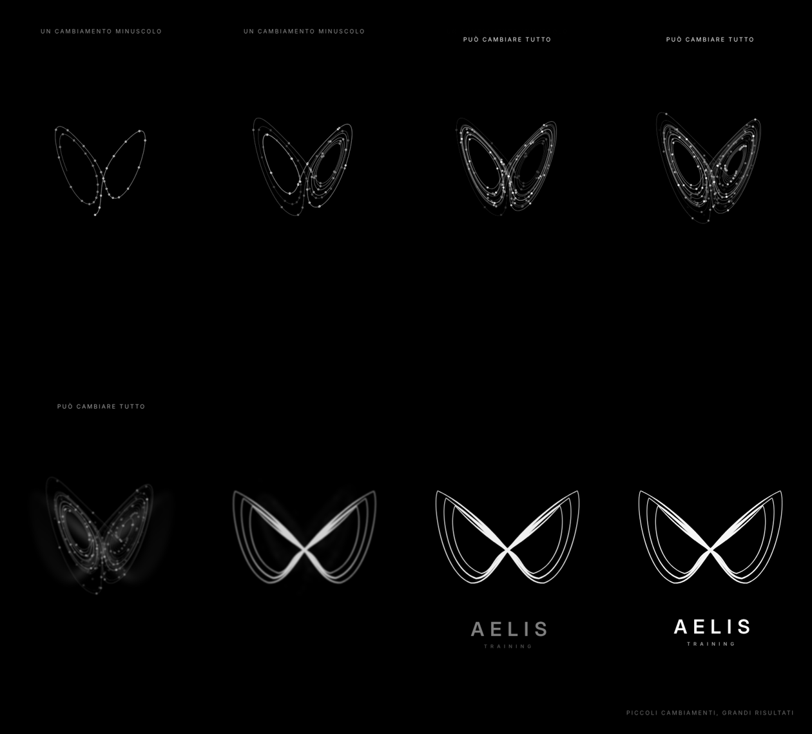
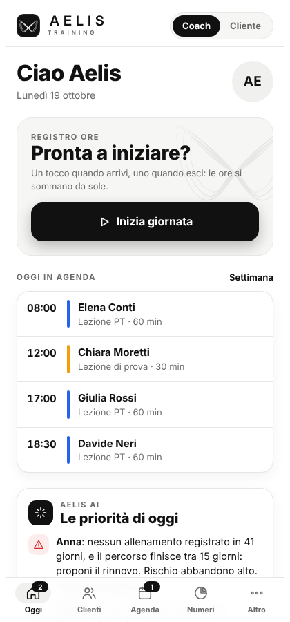
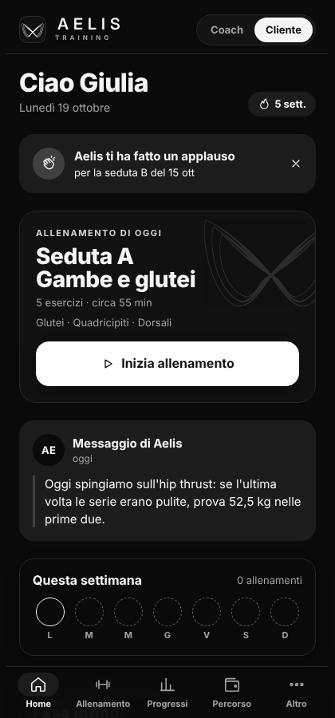
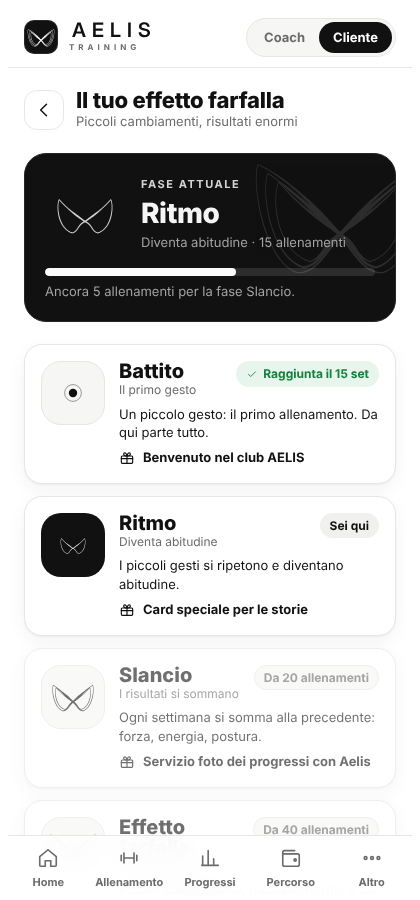
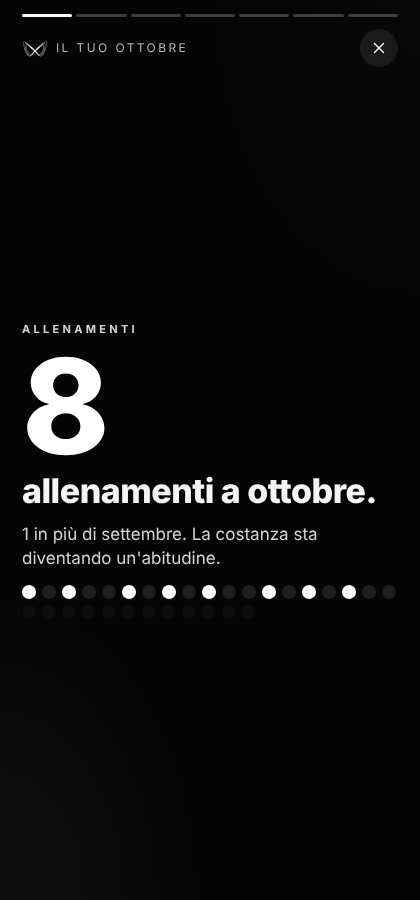
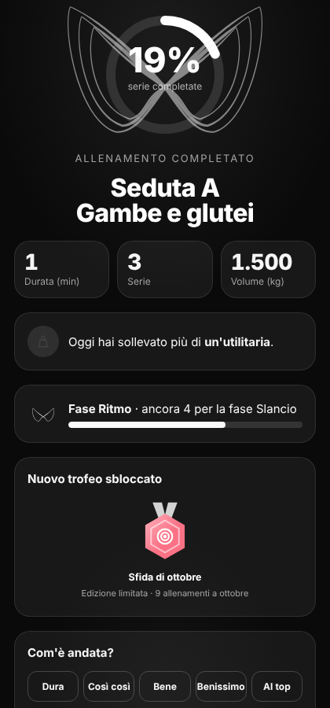

# AELIS Training

**L'app della personal trainer, a costo zero.** Schede, allenamenti, progressi, agenda, pagamenti e motivazione dei clienti in un'unica web app installabile sul telefono.

> *EN — A zero-cost, installable web app (PWA) for an independent personal trainer and her clients: workout plans, live workout logging, progress tracking, scheduling, payments and retention features. Concept, UX and product design by Oussama Anzaoui.*

## Il problema
Una personal trainer che lavora in palestra gestisce clienti, schede, pagamenti e messaggi tra WhatsApp, fogli Excel e note sul telefono. Si perde tempo, si dimenticano rate e scadenze, e i clienti abbandonano senza che nessuno se ne accorga in tempo.

## La soluzione
Una web app con due aree:

| Coach | Cliente |
|---|---|
| Agenda del giorno e registro ore | Allenamento di oggi con serie, carichi e recuperi |
| **Le priorità di oggi**: clienti a rischio abbandono, record, feedback, rate | Dettatura vocale delle serie e cambio esercizio se la macchina è occupata |
| Dossier cliente, schede, percorsi e lezioni | **Il tuo effetto farfalla**: le 4 fasi del percorso |
| Contatti e provenienza dei clienti (social, sala, esterni) | Riepilogo del mese in 7 storie da condividere |
| Automazioni e sfide di gruppo | Trofei, sfide, check settimanale |

## Il concetto
Il logo è la **farfalla di Lorenz**: in matematica un cambiamento minuscolo può produrre conseguenze enormi. È l'idea del brand: *piccoli cambiamenti, grandi risultati*. L'animazione di apertura calcola davvero le equazioni di Lorenz: due traiettorie che partono a un millesimo di distanza si separano e disegnano la farfalla, che diventa il logo.

## Schermate
| Coach · Oggi | Cliente · Home | Effetto farfalla |
|---|---|---|
|  |  |  |

| Riepilogo del mese | Fine allenamento |
|---|---|
|  |  |

## Come è fatta
- **Web app installabile (PWA)**: si apre da un link e si aggiunge alla schermata Home; funziona anche senza connessione.
- **Nessuna compilazione**: HTML, CSS e JavaScript puri, facili da modificare.
- **Database Supabase** (piano gratuito): accesso con link via email, dati in Europa, regole di sicurezza per riga (la coach vede tutto, ogni cliente solo i propri dati). Schema in [`supabase/schema.sql`](supabase/schema.sql), testato con Postgres 16.
- **Hosting GitHub Pages** (gratuito).
- **Modalità demo**: senza chiavi del database l'app parte con dati di esempio inventati, così chiunque può provarla.

## Costi
0 € per partire: GitHub Pages, Supabase Free e un servizio email gratuito per i link di accesso. Dettagli e limiti in [`docs/GUIDA.md`](docs/GUIDA.md).

## Stato del progetto
- [x] Prototipo completo e demo pubblica
- [x] Schema del database con regole di sicurezza
- [ ] Accesso reale e area coach collegata al database
- [ ] Area cliente collegata al database e inviti
- [ ] Pilota con 3–5 clienti veri

Roadmap completa in [`docs/ROADMAP.md`](docs/ROADMAP.md).

## Crediti
Concept, UX/UI e prodotto: **Oussama Anzaoui**. Sviluppo con l'aiuto di Claude (Anthropic).
Marchio e logo AELIS Training appartengono ai rispettivi proprietari: il codice è pubblico per portfolio, il marchio non è riutilizzabile.
